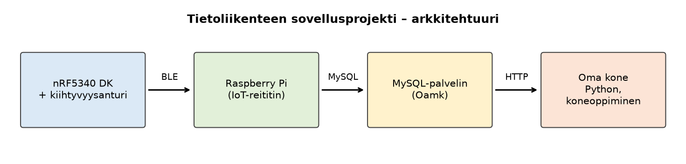

# Tietoliikenteen sovellusprojekti

Oamkin tietoliikenteen sovellusprojekti (TVT25SPL), syksy 2026.

Tekijät: Eino Mänty

## Projektin kuvaus

Projektissa tehdään nRF5340 DK -kehitysalustalle ohjelma, joka lukee kiihtyvyysanturin dataa ja lähettää sen Bluetooth Low Energyn (BLE) kautta Raspberry Pi:lle. Raspberry toimii IoT-reitittimenä ja tallentaa datan Oamkin MySQL-palvelimelle.

Tietokannassa olevaan dataan päästään käsiksi HTTP-rajapinnan ja TCP-soketin kautta. Data haetaan omalle koneelle Python-ohjelmalla, ja sillä opetetaan koneoppimismalli, joka tunnistaa laitteen asennon kiihtyvyysdatasta.

## Arkkitehtuuri

## Työkalut

- **nRF Connect SDK** ja **Visual Studio Code** (nRF Connect -laajennus): kehitysalustan ohjelmointi C-kielellä
- **Python**: Raspberryn BLE-vastaanotin, datan haku tietokannasta ja koneoppiminen
- **MySQL**: mittausdatan tallennus
- **Ubuntu Linux -palvelin**: Apache, PHP ja palomuuri
- **GitHub**: versionhallinta ja Kanban-taulu

## Haarat

- `main`: toimivat ja testatut versiot
- `testailu`: kehitysalustan kokeilukoodit

## Tilanne

- Viikko 1: arkkitehtuurikuva, README ja Kanban-taulu tehty. Kiihtyvyysanturin lukeminen AD-muuntimella testattu omalla laudalla (`testailu/kiihtyvyysanturi`).
- Viikko 2: kiihtyvyysanturin data (suunta, x, y, z) lähetetään BLE:n yli puhelimeen tai tietokoneeseen. Testattu omalla laudalla (`testailu/ble_kiihtyvyysanturi`).

Tätä sivua päivitetään sitä mukaa kun työ etenee.
